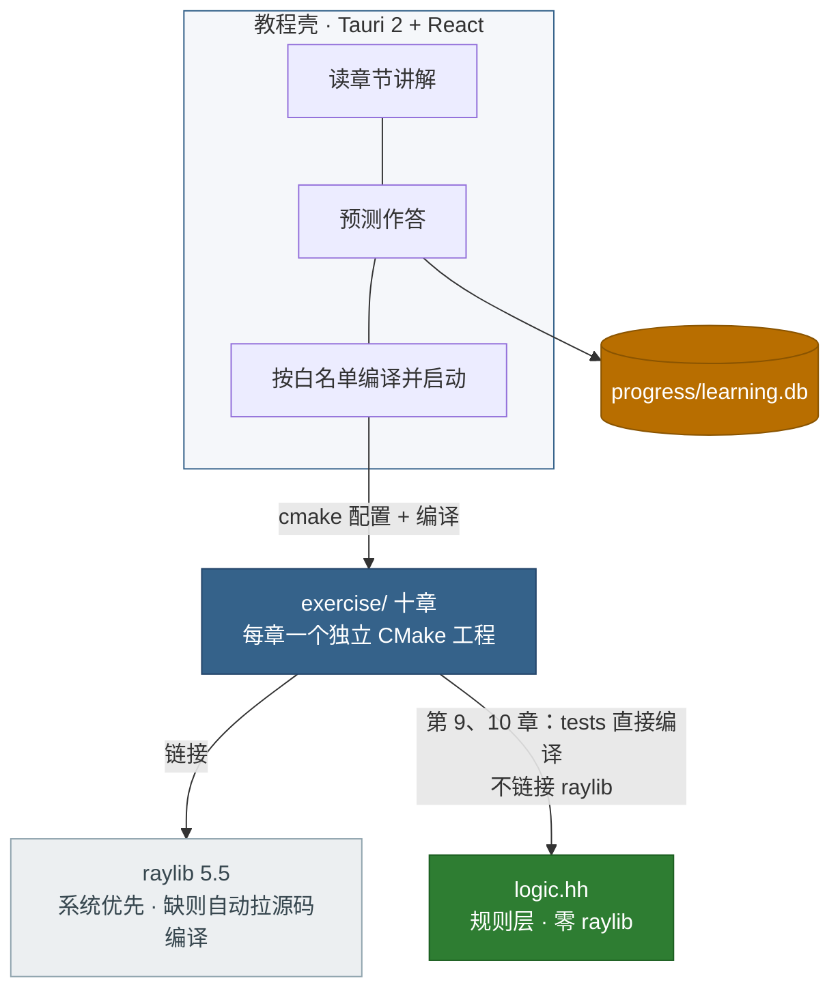

# 贪吃蛇

用 raylib 把一只贪吃蛇按章节做出来。教程是 Tauri 窗口，蛇是每一章自己的 C++ 程序。

这里教的不是「一个贪吃蛇怎么做」，是**程序怎样一步步、一个个阶段变成现在的样子**：
每一章回答上一章留下的一个真实问题，前一阶段的凑合保留到被收编的那一章，章数由演化
阶段数决定。

## 全局结构



## 演化阶梯


## 十章

每章一个目录，自己的 `CMakeLists.txt`，章与章不共用库。后一章是前一章长出来的样子，
源码是另写的一份。第 10 章是当前能玩的版本。

| 目录 | 回答的演化问题 |
| --- | --- |
| `exercise/01-window` | 画面怎么存在？——每帧从头重画的游戏循环 |
| `exercise/02-grid` | 时间怎么走才不乱？——格子世界、固定节拍、累加器补步 |
| `exercise/03-body` | 蛇怎么存在与转向？——蛇身一条队列；折叠 bug 有意留在这章 |
| `exercise/04-input` | 那个 bug 怎么修？——输入缓冲：按键排队，逻辑每步只认一个 |
| `exercise/05-food` | 蛇怎么变长？——吃到是「尾不出队」；变长让「咬到自己」成为新死法 |
| `exercise/06-state` | 开始、暂停、结束怎么办？——四相状态机，收编第三章的凑合 |
| `exercise/07-score` | 玩得怎样怎么算、怎么留？——计分与最高分持久化 |
| `exercise/08-logic` | 规则怎么放心地改？——搬进 `logic.hh`，只搬运不改行为 |
| `exercise/09-test` | 搬出来之后能干什么？——tests/ 直测规则，bug 的触发操作变成断言 |
| `exercise/10-polish` | 手感差在哪？——插值、合成音效、`logic.hh` 演化出加速 |

第 9、10 章的规则在 `logic.hh`，测试在 `tests/logic_test.cc`，不依赖 raylib。第 10 章另有
按需求编号铺开的 `tests/rules_test.cc`。WASD 或方向键，P 暂停。

想看成品**长成了什么样、为什么这样**，读 [设计总览](docs/design/overview.md)：需求、
架构、不变式、关键决策与追溯矩阵。十章讲怎么长出来的，总览讲长成的样子。

## 打开

```sh
launcher open snake
```

只看教程页、不编蛇：`pnpm run dev`，浏览器开 http://localhost:1514 。

单独编某一章（需要 CMake 和一个 C++ 编译器：Windows 装 Visual Studio 的 C++ 工作负载
或 MSYS2 都可以；**raylib 不用预装**，首次配置会自动联网拉源码编译，十章共享
`.cache/fetchcontent` 缓存）：

```sh
cd exercise/10-polish
cmake -B build
cmake --build build
# Windows 下跑测试要带配置名；macOS / Linux 不用
ctest --test-dir build -C Debug
# 编出来的是 build/snake-10.exe
```

## 验证

```sh
python3 scripts/check.py
python3 scripts/check.py --full
python3 scripts/check.py --native
```

默认检查不编译 raylib，CI 因此跑得过。`--native` 在本机把十章都编一遍，并跑第 9、10 章
的规则测试。
