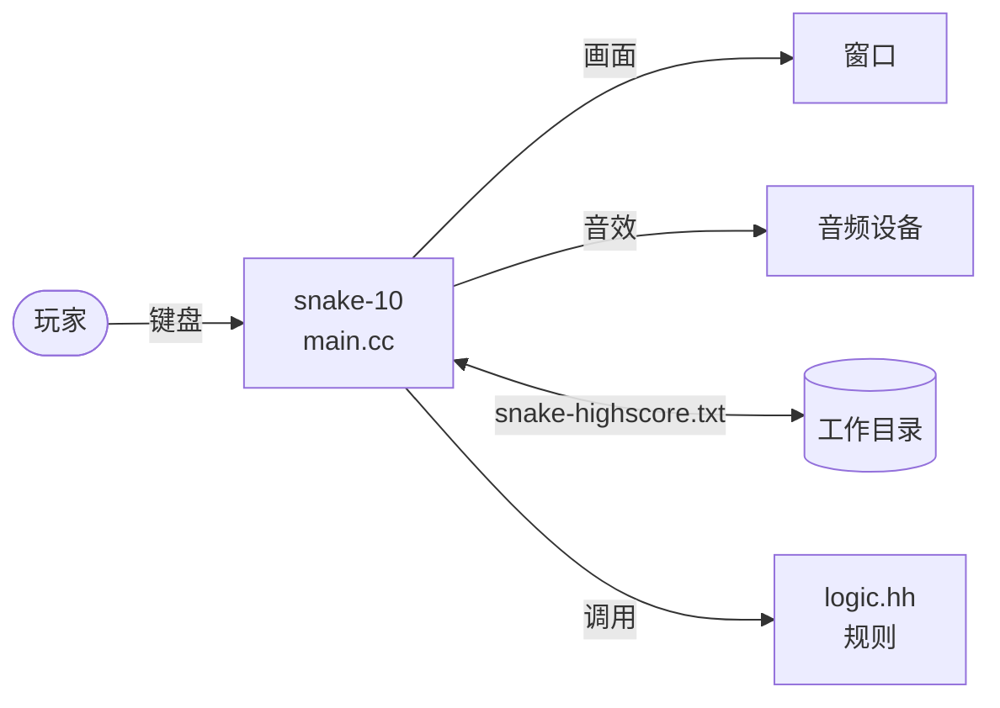
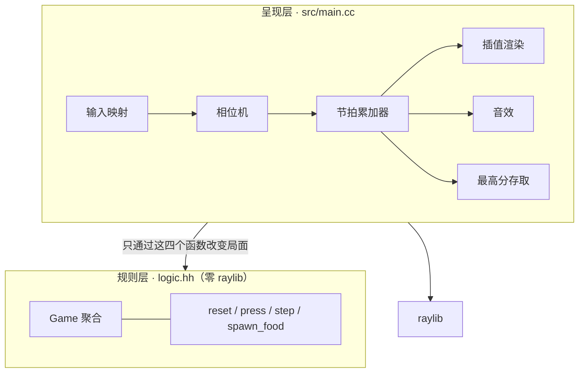
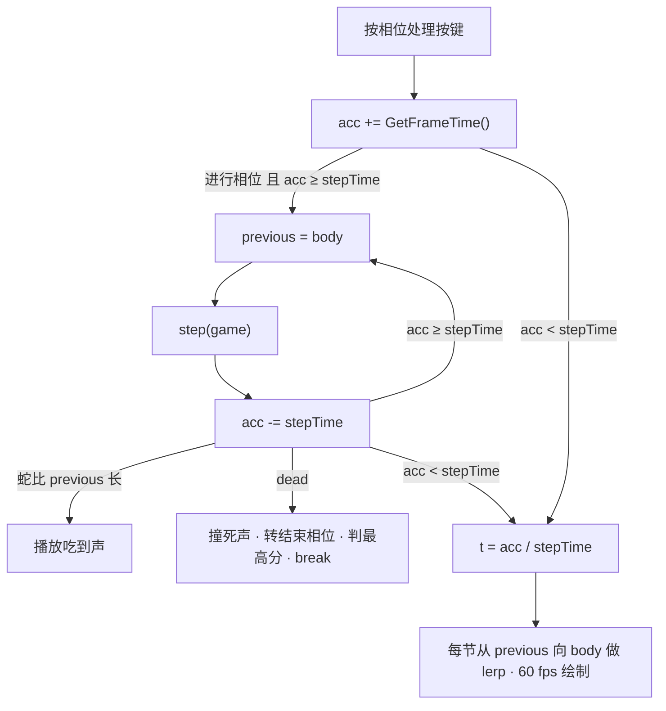
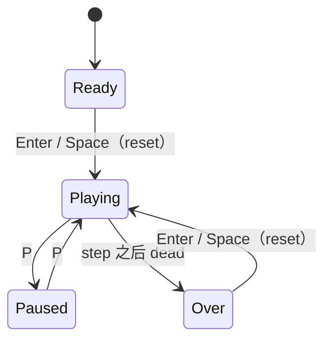
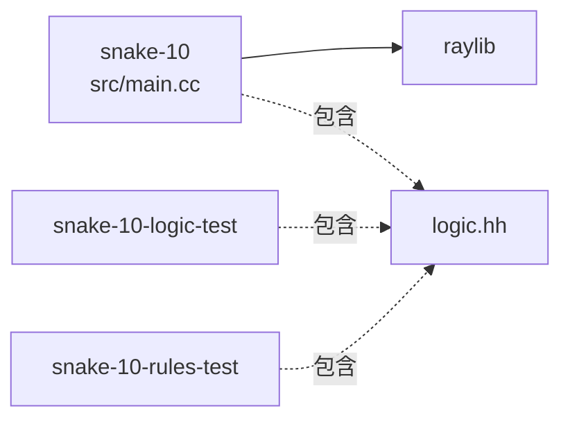

# 贪吃蛇设计总览

- 描述对象：`exercise/10-polish`——第 10 章成品（`logic.hh` + `src/main.cc` + `tests/` + `CMakeLists.txt`）
- 依据：[ADR 0005](../decisions/0005-design-overview-and-traceable-tests.md)
- 读者：要改这份代码的开发者；教程里的「设计篇」是以本文为蓝本的导读，冲突时以本文为准

## 0. 这份文档是什么

这是**回溯性的成品设计**（as-built）：十章是边做边演化出来的，不是先设计后实现的，本文
是对演化终点的整理，不是当初的设计稿，也不据此反推该教什么。

十章讲「怎么长出来的」，本文讲「长成了什么样、为什么这样、怎么确认确实这样」。
各章的演化理由见 ADR 0001～0003，本文只引用结论。

文档与代码的一致性由 `scripts/check.py` 守：追溯矩阵里标「测试」的需求必须有
`@covers` 标记的用例，接口表里的函数必须存在于 `logic.hh`，规则层不得出现 raylib。

## 1. 目标与非目标

目标：一只能玩的、规则可独立测试的贪吃蛇，结构小到能整个读完。

非目标：AI 对手、联网、多人、关卡与道具、中文界面（raylib 默认字体只带 ASCII）、
存档兼容与迁移、鼠标与手柄输入。

## 2. 需求与质量属性

| 编号 | 内容 |
| --- | --- |
| FR-1 | 每个逻辑步，蛇沿当前朝向前进一格；没吃到时尾巴出队，长度不变 |
| FR-2 | 方向输入先进队列：与前一项重复或相反的丢弃，最多缓冲 3 格，每步只消费 1 格 |
| FR-3 | 头到达食物：长一节、加 10 分、步长乘 0.98、重刷食物 |
| FR-4 | 撞墙、撞到自身（含头进入当前尾格）即死；死亡那一步头不入队；死后 `step` 无效 |
| FR-5 | 食物永不刷在蛇身上 |
| FR-6 | `reset` 回到初始局面：三节、朝右、0 分、步长 0.12 秒、缓冲清空 |
| FR-7 | 四个相位：待机、进行、暂停、结束；暂停期间不累积时间 |
| FR-8 | 最高分在死亡时判定，并写入文件，下次启动读回 |
| FR-9 | 吃到、撞死各响一次音效 |
| NFR-1 | 规则层不依赖 raylib，能脱离窗口单独编译和测试 |
| NFR-2 | 逻辑步长与渲染帧率解耦；蛇身在两步之间插值滑动 |
| NFR-3 | 步长有下限 0.06 秒 |
| NFR-4 | 7 条不变式（见第 6 节）在任意输入序列下始终成立 |
| NFR-5 | Windows、macOS、Linux 都能编译运行 |

## 3. 约束与假设

C++20、CMake ≥ 3.21、raylib 5.5（系统有就用，没有则 FetchContent 拉源码编译）。单线程。
棋盘 32×24 格，每格 32 像素，窗口 1024×768。只有键盘：WASD 或方向键、Enter/Space、P。

## 4. 架构

### 4.1 上下文

### 4.2 分层与模块职责

| 模块 | 负责 | 不负责 |
| --- | --- | --- |
| `logic.hh` | 局面数据、移动、转向队列、吃/死判定、计分、加速、食物刷新 | 时间、画面、声音、文件、按键、相位 |
| `main.cc` | 键盘到 `press` 的映射、相位流转、攒时间并调用 `step`、插值渲染、音效、最高分文件 | 任何游戏规则（谁死、谁得分、多快） |

判断一件事归谁的试金石：**关掉窗口，它还成立吗？** 成立，归规则层。

## 5. 运行时视图

### 5.1 一帧之内

音效是对 `step` 的**观察**，判断必须在这一步之内（见 D-7）。暂停与待机时 `acc` 清零、
`t` 取 1，蛇定格在格子正中。

### 5.2 相位

相位只存在于呈现层；规则层只知道 `dead`。

## 6. 数据与不变式

`snake::Game` 是全部局面，按值持有，没有全局状态：

| 字段 | 含义 |
| --- | --- |
| `body` | `deque<Cell>`，头在 `front` |
| `pending` | `deque<Dir>`，输入缓冲 |
| `heading` | 当前朝向 |
| `food` | 食物所在格 |
| `score` | 得分，每吃一口加 10 |
| `stepTime` | 逻辑步长（秒），初始 0.12，每吃一口乘 0.98，下限 0.06 |
| `dead` | 是否已死 |
| `rng` | 刷食物用的随机引擎；放在局面里是为了测试能固定种子 |

不变式（`rules_test.cc` 的 `check_invariants` 逐条检查，随机游走每一步前后各查一遍）：

| 编号 | 内容 |
| --- | --- |
| I-1 | 蛇身非空，相邻两节恰好相接（曼哈顿距离 1） |
| I-2 | 每一节都在棋盘内 |
| I-3 | 蛇身没有重叠的两节 |
| I-4 | 食物在棋盘内，且不压在蛇身上 |
| I-5 | 缓冲不超过 3 格，且每一格相对前一格（首格相对 `heading`）既不重复也不相反 |
| I-6 | `stepTime` ∈ [0.06, 0.12] |
| I-7 | `body.size() == 3 + score / 10` |

持久化：工作目录下的 `snake-highscore.txt`，内容是十进制整数的文本。读到空指针或非数字
按 0 处理。写入在死亡转移那一步，且只在破纪录时。

## 7. 接口

规则层对外只有这些函数；契约以头文件注释和 `rules_test.cc` 为准，下表是摘要。

<!-- api:begin -->
| 函数 | 作用与后置条件 |
| --- | --- |
| `reset` | 回到初始局面（FR-6）并刷新食物；不重置 `rng` |
| `press` | 方向入队；重复、相反或队列已满则无变化；不检查 `dead` |
| `step` | `dead` 时无变化；否则先消费至多一格缓冲，再前进一格并判定；死亡时头不入队 |
| `spawn_food` | 在空格中随机选一格放食物（拒绝采样）；要求至少有一个空格，见 L-1 |
| `occupies` | 某格是否被蛇身占据；纯函数，O(n) |
| `dir_index` | 方向枚举到数组下标，供 `DELTA`、`OPPOSITE` 查表 |
<!-- api:end -->

层间契约：

1. 呈现层只通过上面的函数改变局面，不直接改 `body`、`score`、`dead`。
2. 规则层不调用任何呈现层的东西，不产生回调或事件；呈现层靠比较 `step` 前后的局面来观察发生了什么。
3. 规则层不含 `raylib` 头文件——`scripts/check.py` 机械检查这一条。

## 8. 构建视图

两个测试目标都不链接 raylib（NFR-1）。CTest 名 `snake-logic`、`snake-rules`。MSVC 要加
`/utf-8`；多配置生成器下 exe 输出固定回 `build/` 根，Windows 跑 ctest 要带 `-C Debug`。
教程壳按白名单里的章节 id 编译并启动，不执行任意命令。

## 9. 关键设计决策

| 编号 | 决策 | 备选 | 理由与代价 |
| --- | --- | --- | --- |
| D-1 | 规则与呈现分层，规则层零 raylib | 全部写在 `main.cc` | 规则才能脱离窗口测试（NFR-1）；代价是多一个头文件与一条纪律 |
| D-2 | 固定步长 + 累加器 + 渲染插值 | 每帧按速度连续移动；可变步长 | 规则按格离散、步长确定，便于测试；手感由插值补回 |
| D-3 | 判定先于尾巴出队：头进入**当前尾格**算撞死 | 先出队后判定，允许追尾 | 判定只看当前快照，写法最短；代价是最小回环不可追尾。改它要同时改 `step` 的顺序和 `test_head_into_current_tail_cell_kills` |
| D-4 | 输入队列，容量 3，相对队尾判重与反向 | 直接改朝向（第 3 章的折叠 bug）；只保留最后一键 | 一帧内连按两键不丢键、不会 180° 自撞（ADR 0003） |
| D-5 | 蛇身用 `deque`，头在 `front` | `vector`、环形缓冲 | 两端 O(1)；最长 768 节，不需要更快 |
| D-6 | 食物用拒绝采样 | 维护空格表 | 实现最短；蛇短时期望一次命中。代价见 L-1 |
| D-7 | 音效是对 `step` 的观察，在步内判断 | 规则层回调；事件队列 | 规则层不认识声音；放在步外会让一口食物连响（已修） |
| D-8 | 最高分在死亡转移上判定 | 每次得分都比较 | 一局恰好判定一次，终局才有最终成绩 |
| D-9 | `rng` 放进 `Game` | 全局 `random_device` | 测试可以固定种子，结果可复现 |

## 10. 已知限制

| 编号 | 限制 | 说明与修复方向 |
| --- | --- | --- |
| L-1 | 蛇占满棋盘时 `spawn_food` 死循环 | 需要吃满 765 口，实际基本不可达，但没有胜利判定。修复：满盘判胜，`spawn_food` 先检查有无空格 |
| L-2 | 一帧补步没有上限 | 长帧（拖动窗口、调试器暂停）后 `dt` 很大，一帧内连走很多步，蛇可能瞬间撞死。修复：把 `dt` 钳到一个上限；这属于第 2 章累加器的教学点，改动要连同第 2 章一起考虑 |
| L-3 | 最高分写在进程工作目录 | 教学上有意从简，真实落点应是用户数据目录（第 7 章讲解已说明） |
| L-4 | `logic_test.cc` 用 `assert` | Release 构建定义 `NDEBUG` 后失效；以不受影响的 `rules_test.cc` 为准 |
| L-5 | 只在 Windows + MSVC 本机验证过 | macOS、Linux 未验证（NFR-5） |

## 11. 追溯矩阵

验证方式：**测试**＝有 `@covers` 标记的自动化用例；**人工**＝呈现层行为，只能运行观察；
**未覆盖**＝没有验证。「测试」行由 `scripts/check.py` 核对 `@covers` 标记。

<!-- trace:begin -->
| 编号 | 承担模块 | 验证 | 证据 |
| --- | --- | --- | --- |
| FR-1 | `logic.hh` `step` | 测试 | `rules_test.cc` `test_advance_one_cell`；`logic_test.cc` |
| FR-2 | `logic.hh` `press` `step` | 测试 | `rules_test.cc` `test_input_*`；`logic_test.cc` |
| FR-3 | `logic.hh` `step` | 测试 | `rules_test.cc` `test_eat_grows_scores_speeds_up`；`logic_test.cc` |
| FR-4 | `logic.hh` `step` | 测试 | `rules_test.cc` `test_wall_*` `test_self_bite_*` `test_head_into_current_tail_*` `test_step_after_death_*`；`logic_test.cc` |
| FR-5 | `logic.hh` `spawn_food` | 测试 | `rules_test.cc` `test_food_never_spawns_on_body` |
| FR-6 | `logic.hh` `reset` | 测试 | `rules_test.cc` `test_reset_restores_initial_state` |
| FR-7 | `main.cc` 相位机 | 人工 | 运行第 10 章：待机、暂停、结束各走一遍 |
| FR-8 | `main.cc` 最高分存取 | 人工 | 破纪录后重启，HUD 的 best 保持 |
| FR-9 | `main.cc` 音效 | 人工 | 吃一口听一声；撞死听一声 |
| NFR-1 | `logic.hh`、测试目标 | 测试 | `rules_test.cc` 不链接 raylib 即可编译运行；`check.py` 另查头文件 |
| NFR-2 | `main.cc` 累加器与插值 | 人工 | 运行时蛇身平滑滑动，不跳格 |
| NFR-3 | `logic.hh` `step` | 测试 | `rules_test.cc` `test_speed_floor` |
| NFR-4 | `logic.hh` | 测试 | `rules_test.cc` `test_invariants_hold_under_random_play` |
| NFR-5 | 构建 | 未覆盖 | 仅 Windows + MSVC 本机验证过（L-5） |
<!-- trace:end -->
